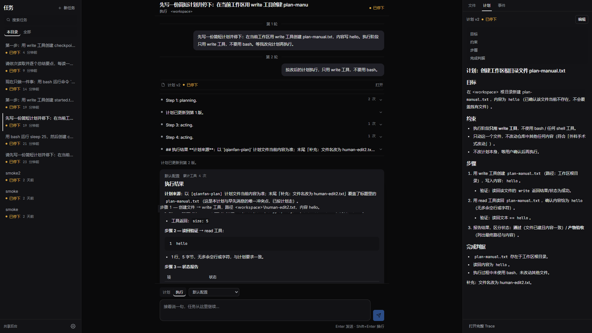

# LangGraph 自主任务 Agent

基于 **LangGraph 1.2.x（StateGraph）** 的自主任务 Agent 平台：自然语言任务 → **一条 loop、计划 / 执行两模式** → 工具调用 → 停下时人看工作区里的文件；FastAPI + React 前后端一体，SSE 实时可视化 + Trace 回放。重点是运行时：多轮续说、checkpoint、模式切换、危险动作拦截、工具生态与可观测性，而不是一个 demo 界面。**离线测试**（零网络、零 Key、MockLLM）· CI 三个 job · 发布前按 [10 个真模型场景](docs/manual-verification.md) 在网页端跑一遍。



## 快速开始

需要 [uv](https://docs.astral.sh/uv/) 与 Node 22（CI 钉 Node 22，本地 22+ 可运行）。仓库外任意目录都能敲 `qianfan`，后台与网页同源起在回环地址；缺 `frontend/dist` 或产物过期时会提示先构建：

```bash
cp .env.example .env                             # LLM_API_KEY 走环境变量；或 use_mock_llm=true 离线
uv tool install -e . --python 3.14                             # 每台机器一次；钉 3.14
cd frontend && npm ci && npm run build && cd ..  # 前端产物；改前端后重跑
qianfan                                          # 自动开浏览器；--port / --no-browser 可选
```

改前端用 `python start.py`（Vite 热重载 + 后端 `--reload`）；开发环境、质量门禁与提交钩子见 [AGENTS.md](AGENTS.md)。

## 核心模型

```text
agent ──有 tool call──> tool ──> agent
  └── 本轮最后一次调用没有 tool call，或停止 / 步数上限 ──> finish（停下）
```

- **一条 loop、一个 `agent` 节点**；模式只换 prompt 和工具面：`plan` = 只读 `explore` 档，`build` = 全部已挂载工具。默认 `build`，开关黏性。
- **停下有三种落点**：本轮最后一次 `agent` 调用没有工具调用；收到停止请求或轮内步数到上限 → `INTERRUPTED`；LLM 错误 → `FAILED`。用户可见状态三值 `RUNNING / INTERRUPTED / FAILED`（`PENDING` 只是创建瞬间），没有「完成」。
- **停下后可以继续说**：`POST /api/tasks/{id}/messages` 沿同一 `thread_id` / checkpoint 续跑并带上新消息；`POST /api/tasks/{id}/resume` 只用于已停下且存在 checkpoint 的任务，不带新消息。checkpoint 用 `SqliteSaver` + `durability="sync"`，格式 v2，v1 旧库按迁移文档 §2.4 拒绝挂载。
- **计划是一个文件**：计划模式下模型把计划写成 Markdown，系统存到任务目录的 `.qianfan/plans/<task_id>.md`；计划区显示原文、可整份编辑（`PUT /api/tasks/{id}/plan`），外部编辑器改同样生效。执行时计划以一条消息进入对话。
- **危险动作**由设置里的 `policy_rules` + 一个钩子当场拒：不弹框、不进图重入；空表 = 不拦（`.env.example` 带一组保守起步规则，理由见 [docs/security.md](docs/security.md) §5）。

## 工作区

- 在哪个目录敲 `qianfan`，新任务就在哪个目录读写、执行命令、加载那里的 `AGENTS.md` 与 `.agents/skills`；页面地址带 `?dir=` 时以它为准（[ADR 0010](docs/adr/0010-launch-dir-workspace-and-model-profiles.md)）。历史默认当前目录，可切「全部」；页面内可切换工作区，任务头标出目录，目录被删后续说返回 409。
- 历史可逐条或按目录删除：只删 `tasks.json` 记录、checkpoint、trace 与 `data/changes/<task_id>/` 变更 sidecar，**不动工作区文件**；运行中的任务会被拒绝（409）。
- 一台机器共用一个后台：日常 `qianfan` 发现健康实例就复用、否则 detach 拉起，关掉启动终端不停后台；停止 / 状态用 `qianfan stop` / `qianfan status`。`start.py` 起的开发后台请回它的终端 Ctrl-C；手工 `uvicorn backend.main:app` 一律被拒。`host` 只允许回环（`127.0.0.1` / `localhost` / `::1`），`0.0.0.0` 等启动期直接拒绝。细节见 [使用手册](docs/usage.md#2-共享后台)。

## 能力

- **工具**：工作区文件读写（`read` / `write` / `edit` / `ls` / `glob` / `grep`）、`shell`（PowerShell 7 / Git Bash 二选一）、`web_search`、MCP（子进程只继承白名单环境变量）。见 [使用手册](docs/usage.md#1-启动工作区与工具)。
- **子代理**：`spawn_subagent` 单入口，`explore` / `execute` 两档，工具面只能收窄，且还要与已启用能力包、父任务已挂载工具取交集。见 [architecture §4.6](docs/architecture.md#46-子任务)。
- **能力包与预设**：六个能力包、三档预设（`minimal` / `research` / `full`，默认 `full`），保存态在 `data/plugins.json`，重启生效；`--preset` 只覆盖本次运行。见 [使用手册](docs/usage.md#6-能力包与预设)。
- **失败与上下文**：工具调用只执行一次（不自动重试、不熔断），失败原因原样回模型；两层 `AGENTS.md` 注入、工具结果逐出与上下文压缩。见 [architecture §4.4 / §4.5](docs/architecture.md#44-上下文供给链)。
- **工作区文件与变更**：Files 树列出按 `.gitignore` 可见的文件，只读预览 / 下载；有 `write` / `edit` 变更的轮次出变更卡，review 页签看 unified / split 差异（不是 git diff）。见 [frontend-design §3–§4](docs/frontend-design.md#3-布局与三栏职责)。
- **计划与续说**：计划文件可整份改；停下后 `messages` 带新消息续说，`resume` 不带。见 [使用手册](docs/usage.md#4-计划续说与续跑)。
- **终端与技能**：`qianfan repl` 是共享后台的薄客户端；输入框 `/` 唤起命令菜单；技能按 home + 任务目录两层发现。见 [使用手册](docs/usage.md#3-终端qianfan-repl) 与 [§7](docs/usage.md#7-技能与命令菜单)。
- **观测**：SSE 事件流 + JSONL trace；Trace 区可按模型调用展开请求 / 响应 / 错误，回放 / 导出。见 [使用手册](docs/usage.md#8-观测与排障)。

## 这不是安全边界

`qianfan` 只监听回环，Host 只认 `127.0.0.1` / `localhost` / `::1`（挡 DNS 重绑定），CORS 只放行自身来源——这些都是**减少暴露面**，不是沙箱：

- **默认没有登录**：同机其他进程 / 用户可以直接驱动 API；`auth_enabled` 只挡无凭据的访问，不是权限边界。
- `shell` 拿到的是**运行账号的权限**：工作目录只是起点，`data/`（含 trace / checkpoint）、`.git`、`.env`、家目录与网络都可读写；撤销靠 git。
- 需要真隔离就放进容器或虚拟机。密钥面、暴露面与危险动作起步集的完整口径见 [docs/security.md](docs/security.md) §1 / §4。

## 文档

| 想知道 | 去这里 |
|---|---|
| 日常操作：工作区、终端、计划 / 续说、模型、能力包、排障 | [docs/usage.md](docs/usage.md) |
| 架构、REST / SSE 契约 | [docs/architecture.md](docs/architecture.md) |
| 安全边界、密钥与暴露面 / UI 设计基线 | [docs/security.md](docs/security.md) · [docs/frontend-design.md](docs/frontend-design.md) |
| 决策记录（0001–0013） | [docs/adr/](docs/adr/) |
| 发布前验收 / OpenCode Go | [docs/manual-verification.md](docs/manual-verification.md) · [docs/opencode-go.md](docs/opencode-go.md) |
| 工程约定 / 术语 / 历史与迁移 | [AGENTS.md](AGENTS.md) · [GLOSSARY.md](GLOSSARY.md) · [docs/archive/OVERVIEW.md](docs/archive/OVERVIEW.md) · [docs/migration-langgraph-1x.md](docs/migration-langgraph-1x.md) |

## License
MIT · [LICENSE](LICENSE)
