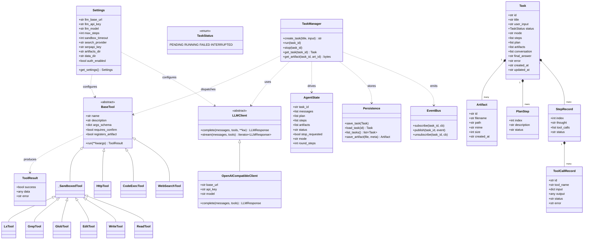
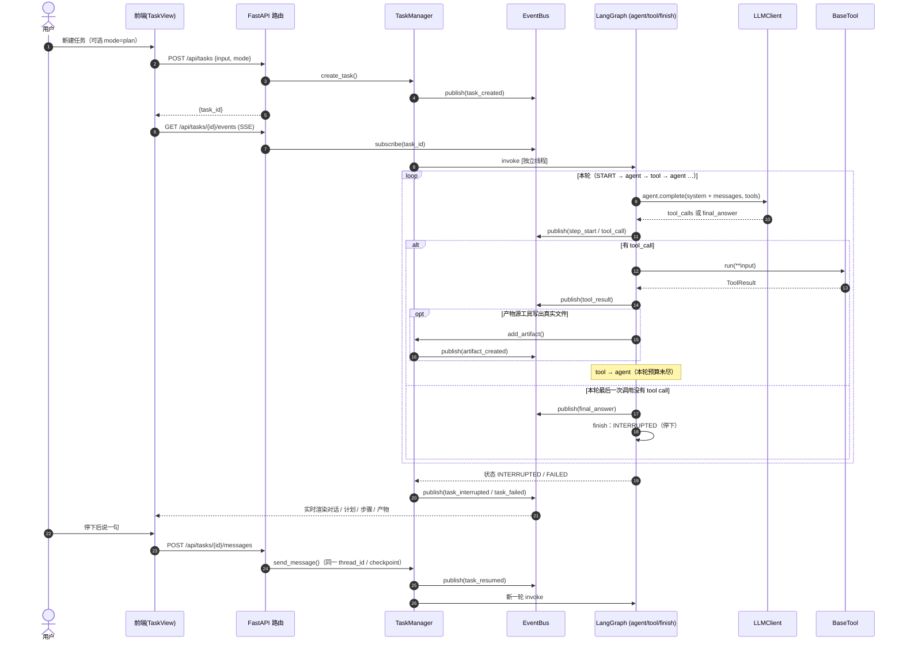
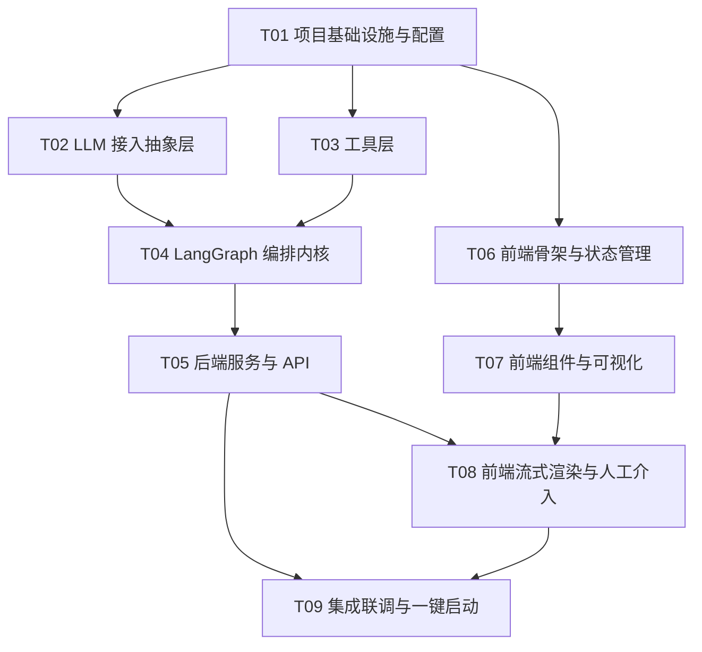

# 系统架构设计文档：基于 LangGraph 的自主任务 Agent 平台

> 架构师：高见远（Gao）　|　版本：v0.1　|　日期：2025-08-24
> 关联文档：PRD（[`docs/prd.md`](prd.md)）
> 项目根目录：仓库根（下文相对路径以仓库根为准）

> ⚠️ **状态：v0.1 原始设计档（历史记录），不是现役架构的权威来源。**
>
> 本文写于 P0 / P1 / P2 / P3 / P0-ABC 七轮迭代之前。其中的文件清单、工具数量、REST
> 端点表、SSE 事件表、类图与时序图均为**当时的计划态**。§2 / §4 已按 S5 的单 loop 更新；
> §5 的跨文件共享约定仍现役；§8 / §9 保留为历史决策与实施计划。
>
> **现役事实请查这里**：
> - 能力清单 → [`README.md`](../README.md)「能力」；工程约定与任务路由 → [`AGENTS.md`](../AGENTS.md)
> - 图拓扑（与代码逐边一致）→ [`README.md`](../README.md)「核心模型」+ [`backend/core/agent/graph.py`](../backend/core/agent/graph.py)
> - 各轮增量设计 → `docs/incremental-arch-p0.md` / `-p1.md` / `-p2.md` / `-p3-resume.md`
> - 接口契约 → 运行时 Swagger `http://localhost:8000/docs`（权威）+ [`backend/api/routes.py`](../backend/api/routes.py)
> - 能力边界的第一性原理推导 → [`capability-first-principles.md`](capability-first-principles.md)
>
> **本文的保留价值**（这些不随实现漂移）：§1 初始技术难点与选型理由、§5 跨文件共享约定
> （其中多数已升格为 `AGENTS.md`「跨任务安全边界」硬规则）、§7 T01–T09 的原始实施顺序、§8 Q1–Q8 的初始决策。

---

## 1. 实现方案 + 框架选型

### 1.1 技术难点分析

| 难点 | 说明 | 解决思路 |
|------|------|----------|
| 自主规划/反思循环 | 需 LLM 驱动多轮"规划→执行→工具→反思"状态机，且可中断 | 用 **LangGraph `StateGraph`** 显式编排节点与条件边，天然支持循环与 human-in-the-loop 中断 |
| 流式可观测 | 后端每一步需实时推给前端，延迟 < 1s | 进程内 **EventBus（pub/sub）** + **SSE** 长连接推送结构化事件 |
| 可控中断 | 用户点"停止"要 2s 内生效 | 任务执行在独立线程/任务中运行，通过 `threading.Event` 信号量中断循环 |
| 多供应商 LLM | 用户可能用 OpenAI / DeepSeek / Ollama | 抽象 **`LLMClient`** 统一接口，底层走 OpenAI 兼容 HTTP |
| 工具安全与可扩展 | 代码执行需隔离；新增工具要低成本 | `BaseTool` 统一契约 + 注册表自动发现；代码执行用受限 subprocess 沙箱 |
| 持久化（P1） | 重启后历史可见 | v1 用 **内存 + JSON 文件落盘**，预留 SQLite 仓储接口 |

### 1.2 框架与库选型

| 层 | 选型 | 版本区间 | 理由 |
|----|------|----------|------|
| 后端语言 | Python | ≥3.10 | LangGraph 生态要求 |
| 编排内核 | `langgraph`（+ checkpoint / checkpoint-sqlite） | langgraph ^1.2、checkpoint 4.2.0、checkpoint-sqlite 3.1.1 | 状态图、节点、中断、流式回调 |
| Web 框架 | `fastapi` + `uvicorn` | fastapi ^0.111、uvicorn ^0.30 | 异步、原生 SSE、自动 OpenAPI |
| 配置 | `pydantic-settings` | ^2.3 | `.env` → 强类型配置 |
| LLM 调用 | `openai` SDK（兼容模式） | ^1.30 | 通过 `base_url` 适配 DeepSeek/Ollama |
| Web 检索 | `duckduckgo-search`（默认免费）/ 预留 SerpAPI | ddgs ^4.0 | 不强制付费 Key |
| 数据校验 | `pydantic` | ^2.7 | 模型与 API schema |
| 前端框架 | React + Vite + TypeScript | react ^18.3、vite ^8.2 | 快速、类型安全 |
| 前端样式 | Tailwind CSS | ^4.3 | 三栏布局、响应式；v4 起配置走 CSS-first（`@theme`），不再有 `tailwind.config.js`（#122）|
| 状态管理 | Zustand | ^4.5 | 轻量、适合 SSE 事件累积 |
| 图表/时间线 | 原生 DOM + Tailwind（不引入重型库） | — | 步骤时间线用列表即可 |

### 1.3 架构模式

- 后端：**分层 + 事件驱动**。API 层（FastAPI）→ 服务层（TaskManager）→ 编排层（LangGraph graph）→ 能力层（LLM / Tools）。执行过程通过 EventBus 解耦并以 SSE 流出。
- 前端：**组件化 + 状态机 UI**。三栏布局，SSE 事件驱动右侧 Step 详情与中部时间线刷新。
- 部署：**单体仓库（monorepo）**，后端独立进程、前端 Vite 开发/构建，由 `start.py` 或 `docker-compose` 统一拉起。

---

## 2. 文件列表及相对路径

> ⚠️ **v0.1 计划态**，保留作原始设计意图记录。现役目录结构（含 `core/agent/` 的
> context/risk/subagent/prompts、`core/kb/`、`core/mcp/`、`docs/adr|specs|agents/`）
> 见仓库实际结构（`backend/` / `frontend/` / `docs/`）。

项目根：`E:\code\demo\langgraph-agent\`

```
langgraph-agent/
├── README.md                         # 启动/部署说明
├── .env.example                      # 配置模板（复制为 .env）
├── requirements.txt                  # Python 依赖
├── pyproject.toml                    # 可选，项目元数据
├── start.py                          # 一键启动（先后端，再前端 dev）
├── docker-compose.yml                # 可选容器化
│
├── backend/                          # ── 后端 ──
│   ├── __init__.py
│   ├── main.py                       # FastAPI app 入口、CORS、挂载路由
│   ├── config.py                     # pydantic-settings：Settings 单例
│   ├── api/
│   │   ├── routes.py                 # REST + SSE 端点
│   │   ├── schemas.py                # 请求/响应 Pydantic 模型
│   │   └── sse.py                    # SSE 响应构造 + 断线清理
│   ├── core/
│   │   ├── agent/
│   │   │   ├── state.py              # AgentState（TypedDict）
│   │   │   ├── graph.py              # 构建 StateGraph（节点+边）
│   │   │   ├── nodes.py              # agent / tool / finish 节点（S5 单 loop）
│   │   │   └── prompts.py           # 系统提示词/工具调用约束
│   │   ├── llm/
│   │   │   ├── client.py            # LLMClient 抽象基类 + LLMResponse
│   │   │   └── openai_compat.py     # OpenAI 兼容实现（OpenAI/DeepSeek/Ollama）
│   │   └── tools/
│   │       ├── base.py              # BaseTool 抽象类 + ToolResult
│   │       ├── registry.py          # 工具注册表/自动发现
│   │       ├── web_search.py        # 联网检索（DuckDuckGo 默认，可插 SerpAPI）
│   │       ├── file_io.py           # 六个沙箱文件工具：read/write/edit/glob/grep/ls
│   │       ├── code_exec.py         # 受限 subprocess 代码执行
│   │       └── http_api.py          # P1：通用 HTTP 请求
│   ├── services/
│   │   ├── event_bus.py             # 进程内 pub/sub（步骤事件）
│   │   ├── persistence.py           # 内存 + JSON 落盘（预留 SQLite 仓储）
│   │   └── task_manager.py          # 任务生命周期：run/stop/resume/续说/模式/计划
│   └── utils/
│       ├── sandbox.py               # subprocess 超时/资源/临时目录封装
│       └── logging.py               # 统一日志
│
└── frontend/                         # ── 前端 ──
    ├── package.json
    ├── vite.config.ts
    ├── tsconfig.json
    ├── tsconfig.node.json
    ├── postcss.config.js          # v4：插件是 @tailwindcss/postcss（无 autoprefixer）
    ├── index.html
    └── src/
        ├── main.tsx                 # React 入口
        ├── App.tsx                  # 根组件 + 三栏布局
        ├── index.css                # v4 CSS-first：@import "tailwindcss" + @theme + @layer base
        ├── api/
        │   └── client.ts            # REST 封装 + SSE 订阅
        ├── types/
        │   └── index.ts             # 与后端 schema 对齐的 TS 类型
        ├── store/
        │   └── taskStore.ts         # Zustand：任务/事件/UI 状态
        ├── hooks/
        │   └── useSSE.ts            # EventSource/流式订阅 hook
        ├── components/
        │   ├── HistoryPanel.tsx     # 左：历史任务列表
        │   ├── TaskPanel.tsx        # 中：任务主区容器
        │   ├── TaskHeader.tsx       # 顶部：标题+状态徽章+停止
        │   ├── MessageStream.tsx    # 对话/任务流（消息）
        │   ├── StepTimeline.tsx     # 步骤时间线（规划+工具）
        │   ├── StepDetail.tsx       # 右：当前 step 入参/出参/日志
        │   ├── InputBar.tsx         # 输入框+发送+停止
        │   ├── ArtifactList.tsx     # 产物列表+下载/预览
        │   ├── PlanPanel.tsx        # 计划区（停下时可改）
        │   ├── ModeSwitch.tsx       # 计划 / 执行模式开关
        │   ├── TraceTab.tsx         # Trace 回放
        │   ├── SubtaskList.tsx      # 子任务面板
        │   └── KbPanel.tsx          # 知识库面板
        └── pages/
            └── TaskView.tsx         # 单个任务页（组合上述组件）
```

---

## 3. 数据结构和接口

### 3.1 类图 / 数据模型（mermaid `classDiagram`）

> 详见 `docs/class-diagram.mermaid`。



### 3.2 关键数据模型（Pydantic 字段摘要）

| 模型 | 关键字段 |
|------|----------|
| `TaskStatus` | `PENDING / RUNNING / FAILED / INTERRUPTED`（三值循环：跑着 / 停下 / 出错；没有「完成」，ADR 0008 决策 5） |
| `Task` | `id, title, user_input, status, mode(plan/build), steps[], plan[], artifacts[], conversation[]:ChatTurn, final_answer, error, created_at, updated_at` |
| `StepRecord` | `index, thought, tool_calls[]:ToolCallRecord, status` |
| `ToolCallRecord` | `id, tool_name, input, output, status(success/failed), error, circuit_open, retries` |
| `PlanStep` | `index, description, status(pending/active/done)` |
| `Artifact` | `id, filename, path, mime, size, created_at` |
| `ToolResult` | `success:bool, data:Any, error:str` |
| `LLMResponse` | `content:str, tool_calls:list, raw:dict` |

### 3.3 REST + SSE 接口定义

> 现役端点以 `backend/api/routes.py` + Swagger 为准（本文不写计数）。
> 新增：`POST /tasks/{id}/resume`（P3）、`GET /tasks/{id}/trace`（P0）、`GET /kb` +
> `POST /kb/rebuild` + `DELETE /kb/{doc_id}`（P1）、`GET /mcp/servers`（P2）、
> `POST /tasks/{id}/rollback`（P1-B）；S5（#139）新增 `PUT /tasks/{id}/mode`、
> `PUT /tasks/{id}/plan`、`POST /tasks/{id}/messages`、`POST /tasks/{id}/replan`。
> `/health` 另在 `backend/main.py`。下表其余契约仍现役。

**基础路径**：`/api`　**内容类型**：`application/json`

| 方法 | 路径 | 说明 | 请求体 / 参数 | 响应 |
|------|------|------|---------------|------|
| POST | `/api/tasks` | 下发新任务（默认 build 模式） | `{title?:str, input:str, mode?:plan\|build}` | `{task_id:str}` |
| GET | `/api/tasks` | 历史任务列表 | query: `?limit=50` | `{tasks: Task[]}` |
| GET | `/api/tasks/{id}` | 任务完整状态 | path `id` | `Task` |
| POST | `/api/tasks/{id}/stop` | 停止任务 | path `id` | `{ok:bool, status:str}` |
| GET | `/api/tasks/{id}/events` | **SSE 流式事件**（见 3.4） | path `id` | `text/event-stream` |
| GET | `/api/tasks/{id}/artifacts/{aid}` | 下载产物 | path `id,aid` | `application/octet-stream` |
| GET | `/api/tasks/{id}/artifacts/{aid}/preview` | 预览产物（文本/图片） | path `id,aid` | 按 mime 返回 |
| POST | `/api/auth/token` | P1 鉴权（auth_enabled 时） | `{token:str}` | `{ok:bool}` |

**统一响应信封**：`{code:int, data:any, message:str}`（错误时 `code≠0`）。

### 3.4 SSE 事件协议（步骤事件 schema）

> ⚠️ **现役清单以下表为准，本文不写计数**（计数每次增删都要重推一遍，23→24 连续两代
> 都错在这里；同 `AGENTS.md`「文档不写现役测试计数（数字必腐，以实跑为准）」一个道理）。
> v0.1 只有 12 种，此后新增的都在下表行内标了来源。
> `subtask_start` / `subtask_result` / `subtask_failed`：#56 删入口 B 时曾退役（后端零发布点），
> **#70 裁定 A 已把生产者补回 `spawn_subagent` 路径**——三条汇总事件重发在**父频道**上，见下表末三行。
> 「子任务失败改由一条失败的 tool call 带回、父任务不死」那半契约没变，两条并存。
> 面板（`SubtaskList`）数据源是 REST 的 `Task.subtasks`，不吃这三条事件；事件只进 Trace 时间线。
> 前端两处注册表：`frontend/src/hooks/useSSE.ts` 的 `EVENT_TYPES`（EventSource **只派发注册过的
> 类型**——漏注册不是「显示不全」，是静默收不到）与 `frontend/src/types/index.ts` 的
> `SSEventType` 联合。本表、两处注册表与后端发布点由 `npm run check:sse` 逐条对齐，已接进 CI 的
> frontend job（#92）。「后端发布点」这侧另有第二条机械路径：`backend/tests/test_sse_publish_ast.py`
> 用 `ast` 枚举发布调用的字符串字面量类型实参、与本表第一列比对，跑在 CI 的 backend-test job（#104）。
> 两条并存互为备份（`.mjs` 守前端 job 且跑得快，pytest 这条守「发布点枚举」本身），谁先漂谁先红。
> 共同的盲区是**类型经变量名传入**的发布调用——两条路径都只认字面量，那种事件必须手工同步四处，
> 不许指望机械门。唯一不对称是 `trace_end`：只写 trace JSONL、不经 EventBus，故进联合不进订阅表。
> **改本表的 PR 会触发全套 CI**（#103）：`ci.yml` 的触发面是 `paths` 白名单，末尾的正模式把本文件
> 单独收了回来——表与代码一漂就红在本次 PR 上，不用等下一张不相干的前端 PR。

`GET /api/tasks/{id}/events` 推送 `event: <type>\ndata: <json>\n\n`：

| event 类型 | data 字段 | 含义 |
|------------|-----------|------|
| `task_created` | `{task_id, title, status}` | 任务已创建 |
| `plan_update` | `{plan: PlanStep[]}` | 计划更新：计划模式一轮产出，或停下时人工编辑（`PUT /tasks/{id}/plan`） |
| `step_start` | `{index, thought}` | 一次 `agent` 调用（步）开始；一轮可含多步（工具往返），两种模式同形 |
| `tool_call` | `ToolCallRecord` | 即将/正在调用工具 |
| `tool_result` | `ToolCallRecord`（含 `output/status`） | 工具返回 |
| `artifact_created` | `Artifact` | 产物登记：仅产物源工具（`registers_artifact=True`）写出真实文件时，任务内同一路径只发一条（ADR 0004） |
| `final_answer` | `{answer:str}` | 本轮的文字回复（不是终态；下一轮会覆盖） |
| `task_failed` | `{task_id, error}` | 失败 |
| `task_interrupted` | `{task_id, status}` | 停下：人按停、这一轮的最后一次 `agent` 调用没有工具调用、或步数用尽——界面上不加区分（ADR 0008 决策 5） |
| `task_resumed` | `{task_id, status}` | 从检查点续跑 / 新消息续跑启动（P3；#139 起多轮对话共用） |
| `tool_result_evicted` | `{tool_call_id, tool_name, original_chars, step_index}` | 旧的大段 tool 结果被换成占位（T1.4，全文留 trace） |
| `tool_circuit_open` | `{tool_name, cooldown_sec}` | 熔断跳闸：工具未执行、进入冷却（韧性层直发，不经 AgentRuntime） |
| `context_compressed` | `{step_index, dropped, band_evicted, converged, context_tokens, strategy}` | 上下文压缩发生。#49 起含带内挤压：`band_evicted` = 保护带里被挤成便签的条数；`converged` = 结果是否已进预算，`false` = 角色闸门下够不到、已如实停手不空转 ；`strategy=summarize` 时同样可非 0，`dropped=0` 时也可非 0（#85：摘要与截断共享带内挤压）|
| `task_rollback` | `{task_id, ok, files, already_original}` | 工作区回滚完成（P1-B，`files` = 实际变动的沙箱内路径） |
| `subtask_start` | `{subtask_id, name, status, parent_task_id}` | 子任务已派生（#70 裁定 A 恢复；**只发在父频道**，子任务自己的频道不带） |
| `subtask_result` | `{subtask_id, name, status, summary, artifacts}` | 子任务 `completed` 的折叠回传（#70 裁定 A；父频道） |
| `subtask_failed` | `{subtask_id, name, error}` | 子任务超时 / worker 崩溃 / 折回 `failed`（#70 裁定 A；父频道，与一条失败的 `tool_result` 并存、父任务不死） |
| `heartbeat` | `{}` | 保活（每 15s） |

---

## 4. 程序调用流程（mermaid `sequenceDiagram`）

> 现役拓扑与 `backend/core/agent/graph.py` 逐边一致；下图是一次 plan → build → 停下 → 续说
> 的典型调用。`POST /replan` 只是借一轮 plan 模式，不改任务上的模式开关。

> 详见 `docs/sequence-diagram.mermaid`。



---

## 5. 共享知识（跨文件约定）

> 工程师编码前务必遵循以下全局约定。

1. **配置管理**：所有配置经 `backend/config.py` 的 `Settings`（`pydantic-settings`），从 `.env` 读取。**禁止**在业务代码中硬编码 Key/路径；通过 `get_settings()` 获取单例。
2. **LLM 接入抽象层**：业务只依赖 `LLMClient` 抽象。调用统一返回 `LLMResponse{content, tool_calls, raw}`。新增供应商只需新增 `LLMClient` 子类并据 `Settings` 选择；支持 OpenAI / DeepSeek / 本地 Ollama（仅改 `base_url`）。
3. **工具接口规范 `BaseTool`**：
   - 每个工具实现 `name / description / args_schema(dict) / requires_confirm / registers_artifact / run(**kwargs)->ToolResult`；
   - `args_schema` 必须是 JSON Schema（供 LLM function calling 使用）；
   - 工具务必返回 `ToolResult`，**禁止**抛未捕获异常导致进程崩溃（外层统一 try/except 兜底）；
   - 新工具在 `registry.py` 中 `@register` 即被 Agent 自动发现（满足 SC4 上手 <30min）。
4. **事件/消息协议**：后端 → 前端仅通过 SSE 事件（见 3.4）通信；事件 `data` 为 JSON，字段名与后端模型一致；前端 `types/index.ts` 必须与后端 schema 保持字段对齐（单一事实来源：后端 `schemas.py`）。
5. **错误与重试约定**：工具失败返回 `ToolResult(success=False, error=...)`；`code_exec`/`http_api` 支持按 `Settings` 重试（默认退避 2s×2）。LangGraph 节点级异常被 `TaskManager` 捕获并 `publish(task_failed)`。失败的理由**两个面各说一次**（#95）：事件面 `tool_result.error`（人可见），对话面 `role:"tool"` 消息 `{"ok": false, "error": ...}`（模型可见）——两者取同一个 `rec["error"]`。被 `policy_rules` 当场拒掉的调用（S2）走**第三条**形状：对话面 `{"block": true, "reason": ...}`，记录面 `status:"skipped"` + 理由在 `error`（「不许做」与「做失败了」分得开，ADR 0008 决策 6）。
6. **停止信号**：`AgentState.stop_requested` 由 `TaskManager.stop()` 置位；图节点在下一入口检测，为真则走 `finish` 并发布 `task_interrupted`（P0-9：2s 内生效）。
7. **危险动作拦截**：设置里的 `policy_rules` 规则表 + `agent` 里那一个钩子；命中即当场拒，不执行、不弹框、不进图重入。详见 [ADR 0008](adr/0008-single-loop-plan-build-modes.md) 决策 6 与 `backend/core/agent/policy.py`。
8. **产物与路径安全**：所有文件读写限定在 `Settings.artifacts_dir` / 沙箱白名单目录；越界路径一律拒绝（P0-4）。产物 = 本任务写出的文件，判据与去重口径见 [ADR 0004](adr/0004-artifact-is-what-the-task-wrote.md)。
9. **停下判定（Q8）**：一轮的最后一次 `agent` 调用没有工具调用 → `finish` 把任务停成 `INTERRUPTED`；错误 → `FAILED`。没有 `COMPLETED` 终态。
10. **日志**：统一经 `utils/logging.py`，结构化输出到控制台 + `data_dir/logs/`；不打印明文 API Key。

---

## 6. 依赖包列表

### 6.1 Python（`requirements.txt`）

> 完整依赖、钉版区间与理由以仓库根 `requirements.txt` 为准；本节只列核心，避免逐行复制再次滞后。

```
langgraph>=1.2,<1.3
langgraph-checkpoint==4.2.0
langgraph-checkpoint-sqlite==3.1.1
fastapi>=0.111.0,<0.113.0
uvicorn[standard]>=0.30.0,<0.31.0
pydantic>=2.7.0,<3.0.0
pydantic-settings>=2.3.0,<3.0.0
openai>=1.30.0,<2.0.0
duckduckgo-search>=4.0.0,<5.0.0
python-dotenv>=1.0.0
httpx>=0.27.0          # 供 http_api 工具使用
```

### 6.2 前端（`frontend/package.json`）

```
{
  "dependencies": {
    "react": "^18.3.1",
    "react-dom": "^18.3.1",
    "zustand": "^4.5.0"
  },
  "devDependencies": {
    "@tailwindcss/postcss": "^4.3.3",
    "@types/react": "^18.3.0",
    "@types/react-dom": "^18.3.0",
    "@vitejs/plugin-react": "^6.1.0",
    "postcss": "^8.4.0",
    "tailwindcss": "^4.3.3",
    "typescript": "^5.5.0",
    "vite": "^8.2.2"
  }
}
```

---

## 7. 有序任务列表（工程师编码依据）

> ⚠️ **历史**：T01–T09 是 v0.1 首轮实施顺序，均已交付。后续七轮的任务拆分见
> `docs/incremental-prd-p{0,1,2}.md`；当前待做清单见
> [`roadmap-pawbench.md`](roadmap-pawbench.md) §三 与 GitHub Issues。

> 说明：任务按**实现依赖顺序**排列，每个任务含 ≥3 个文件。`T01` 为项目基础设施（必为首个任务）。优先级：`P0`=MVP，`P1`=重要。任务粒度到"可独立编码"。

| ID | 任务名 | 源文件（核心） | 依赖 | 优先级 |
|----|--------|----------------|------|--------|
| T01 | 项目基础设施与配置 | `backend/config.py`、`backend/__init__.py`、`requirements.txt`、`frontend/package.json`、`frontend/vite.config.ts`、`frontend/tsconfig.json`、`frontend/tailwind.config.js`、`frontend/index.html`、`start.py`、`.env.example`、`README.md` | — | P0 |
| T02 | LLM 接入抽象层 | `backend/core/llm/client.py`、`backend/core/llm/openai_compat.py`、`backend/utils/logging.py` | T01 | P0 |
| T03 | 工具层（BaseTool + 四件套） | `backend/core/tools/base.py`、`backend/core/tools/registry.py`、`backend/core/tools/web_search.py`、`backend/core/tools/file_io.py`、`backend/core/tools/code_exec.py`、`backend/utils/sandbox.py`、`backend/core/tools/http_api.py` | T01 | P0/P1 |
| T04 | LangGraph 编排内核 | `backend/core/agent/state.py`、`backend/core/agent/graph.py`、`backend/core/agent/nodes.py`、`backend/core/agent/prompts.py` | T02, T03 | P0 |
| T05 | 后端服务与 API | `backend/services/event_bus.py`、`backend/services/persistence.py`、`backend/services/task_manager.py`、`backend/api/schemas.py`、`backend/api/routes.py`、`backend/api/sse.py`、`backend/main.py` | T04 | P0 |
| T06 | 前端骨架与状态管理 | `frontend/src/main.tsx`、`frontend/src/App.tsx`、`frontend/src/index.css`、`frontend/src/types/index.ts`、`frontend/src/store/taskStore.ts`、`frontend/src/api/client.ts` | T01 | P0 |
| T07 | 前端组件与三栏可视化 | `frontend/src/components/HistoryPanel.tsx`、`TaskPanel.tsx`、`TaskHeader.tsx`、`MessageStream.tsx`、`StepTimeline.tsx`、`StepDetail.tsx`、`InputBar.tsx`、`ArtifactList.tsx`、`pages/TaskView.tsx` | T06 | P0 |
| T08 | 前端流式渲染与交互 | `frontend/src/hooks/useSSE.ts`、`MessageStream` / `PlanPanel` / `ModeSwitch`（增强 `StepDetail`/`ArtifactList` 下载预览） | T05, T07 | P0/P1 |
| T09 | 集成联调与一键启动 | `start.py`（联调）、`docker-compose.yml`、`README.md`（补充）、端到端 demo 验证脚本 | T05, T08 | P0 |

### 7.1 实现顺序建议

```
T01(基建) → T02(LLM) ┐
                     ├→ T04(编排) → T05(服务/API) ┐
        T01 → T03(工具) ┘                          ├→ T09(联调)
        T01 → T06(前端骨架) → T07(组件) ───────────┘
                                            T08(流式/交互) ↑依赖 T05,T07
```

---

## 8. 待明确事项与已确认技术决策

> ⚠️ **Q1–Q8 大体仍现役**，两处已被超越：**Q3 持久化**——任务记录仍走 JSON，但
> P3 已把 sqlite 真正用起来（`langgraph-checkpoint-sqlite` 存对话快照，含格式守卫）；
> **Q7 人工介入**——确认闸门已随 ADR 0008 退役，危险动作改由 `policy_rules` + 钩子当场拒。
> §8.2 的 4 项待定均已落定（能力概述以 [`README.md`](../README.md)「能力」为准）。

### 8.1 已确认技术决策（面向本地 demo，可后续调整）

| 问题 | 决策 | 说明 |
|------|------|------|
| **Q1 前端栈** | **React + Vite + TypeScript + Tailwind** | 见 T01/T06/T07 |
| **Q2 LLM** | **OpenAI 兼容接口**，抽象 `LLMClient`；`base_url`+`api_key`+`model` 经 `.env`；支持 OpenAI / DeepSeek / 本地 Ollama | 见 T02 |
| **Q3 持久化** | v1 **内存 + JSON 文件落盘**（任务记录 + 产物），**预留 SQLite 仓储**（`Persistence` 抽象隔离） | 见 `persistence.py` |
| **Q4 鉴权** | v1 **本地 demo 不做登录鉴权**；`Settings.auth_enabled=False`；接口预留 `POST /api/auth/token`（P1-6 仅在公网时开启） | 文档注明 |
| **Q5 沙箱** | **受限 subprocess**（独立临时目录 + 超时 + 基础资源限制）；Docker 作为可选增强，**首版不强制** | 见 `sandbox.py`/`code_exec.py` |
| **Q6 web search** | **内置可插拔搜索工具**，默认轻量免费方案 **DuckDuckGo**（`ddgs`），预留 SerpAPI 接口（需 Key 时配置） | 见 `web_search.py` |
| **Q7 人工介入** | **已随 ADR 0008 退役**：没有确认闸门 / 人工确认节点；危险动作由 `policy_rules` + 钩子当场拒 | 见 §5.7 |
| **Q8 停下度量** | 一轮的最后一次 `agent` 调用没有工具调用 → `INTERRUPTED`（停下）；错误 → `FAILED`；没有 `COMPLETED` | 见 §5.9 |

### 8.2 仍需用户/产品最终确认的极少数项（非阻塞，已给默认值）

1. **默认 LLM 供应商**：当前默认占位为 OpenAI 兼容，需用户填入实际 `base_url/api_key`（或确认用 DeepSeek/Ollama）。→ 已默认提供 `.env.example`，用户启动时填即可。
2. **`max_steps` 默认值**：当前默认 `15`（PRD P0-1），如需调整请在 `.env` 覆盖。
3. **Web 检索默认供应商**：默认 DuckDuckGo（免费）；若需更高召回率是否启用 SerpAPI（付费）？→ 已预留接口，按需开启。
4. **鉴权范围**：确认 v1 仅本地 demo（无鉴权）是否被接受；若需公网演示则开启 `auth_enabled` 与 `P1-6`。

> 以上 4 项均不阻塞开发，架构已按"可配置、可插拔"设计，后续调整无需改核心代码。

---

## 9. 任务依赖图（mermaid `graph`）


